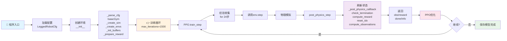

## legged gym

### 代码框架结构

```
legged_gym/
├── legged_gym/
│   ├── envs/              # 环境实现
│   │   ├── base/          # 基类和配置
│   │   │   ├── legged_robot.py              ⭐ 核心环境类
│   │   │   ├── legged_robot_config.py       ⭐ 配置文件
│   │   │   ├── base_task.py                 # 父类
│   │   │   └── base_config.py       # 配置定义
│   │   ├── a1/            # A1机器人
│   │   ├── anymal_b/      # ANYmal B机器人
│   │   ├── anymal_c/      # ANYmal C机器人
│   │   └── cassie/        # Cassie机器人
│   │
│   ├── utils/             # 工具模块
│   │   ├── task_registry.py       # 任务注册
│   │   ├── terrain.py             # 地形生成
│   │   ├── math.py                # 数学工具
│   │   ├── helpers.py             # 辅助函数
│   │   └── logger.py              # 日志
│   │
│   └── scripts/           # 执行脚本
│       ├── train.py               # 训练脚本
│       └── play.py                # 推理脚本
│
└── resources/
    └── robots/            # 机器人模型文件
        ├── a1/urdf/
        ├── anymal_b/urdf/
        └── cassie/urdf/
```

### 训练流程



1. scripts/train.py：

   - 训练脚本，也就是程序入口。主函数中通过 utils/helpers中的工具函数get_args获取参数，参数传入train函数通过train函数开启训练

   - train函数中：根据参数创建并初始化仿真环境（**make_env**）；创建ppo训练器（**make_alg_runner**），并使用ppo进行训练（**learn**）

     - make_env：

       ```
       make_env()
       ├── 获取注册的任务类（例如：flat_anymal_c）
       ├── 加载环境配置 env_cfg
       ├── 更新配置（从命令行参数覆盖）
       ├── 解析物理引擎参数 (IsaacGym)
       ├── 调用 task_class() → 创建 LeggedRobot 对象
       │   ├── _parse_cfg()
       │   ├── _create_sim()（IsaacGym物理引擎）
       │   ├── _create_envs()（创建4096个平行环境）
       │   ├── _init_buffers()（初始化张量）
       │   └── _prepare_reward_function()（构建奖励函数）
       └── 返回 (env, env_cfg)
       ```

     - make_alg_runner

       ```
       make_alg_runner()
       ├── 加载训练配置 train_cfg（LeggedRobotCfgPPO）
       ├── 创建日志目录
       │   └── logs/<experiment_name>/<timestamp>_<run_name>/
       ├── 创建 OnPolicyRunner 对象 (在另一个包：rsl_rl)
       ├── 如果 resume=True，加载之前保存的检查点模型
       └── 返回 (runner, train_cfg)
       ```

     - learn：主循环训练，持续更新策略网络直到收敛（在rsl_rl）

       ```
       learn() 循环 1500 次
       │
       ├─ for iteration in range(1500):
       │
       │  ① 收集经验 (num_steps_per_env=24)
       │  │  ├─ for step in range(24):
       │  │  │  ├─ 策略网络前向推理：action = policy(obs)
       │  │  │  ├─ 执行一个时间步：env.step(action)
       │  │  │  │  ├─ 动作裁切限制输出上限
       │  │  │  │  ├─ 执行一步物理模拟（IsaacGym）
       │  │  │  │  ├─ 状态更新和奖励计算等：post_physics_step
       │  │  │  │  └─ 返回 (obs, reward, done, info)
       │  │  │  └─ 存储到经验缓冲区
       │  │  └─ 收集 24×4096 = 98,304 个 step 的经验
       │
       │  ② PPO 离线训练
       │  │  ├─ 计算优势函数 (advantage) 和目标值
       │  │  ├─ for epoch in range(num_learning_epochs=5):
       │  │  │  ├─ 将数据分为 mini-batches
       │  │  │  ├─ 使用 PPO 损失函数更新策略网络
       │  │  │  ├─ 使用 MSE 损失函数更新价值网络
       │  │  │  └─ 记录训练指标
       │  
       │  ③ 保存与日志
       │     ├─ 每50步保存一次模型 checkpoint
       │     ├─ 记录到 Tensorboard
       │     └── 显示训练进度
       │
       └─ 训练完成 → 返回最终模型
       ```
       
       奖励函数的添加和使用
       
       - 添加：prepare_reward_function()
         -  移除scale为0的奖励
         -  填充reward_functions和reward_names
            -  从reward_scales中提取出name scale用来填充
            -  reward scales在_parse_cfg中通过调用helpers.py中class_to_dict函数赋值
            -  class_to_dict传入的参数是LeggedRobotCfg中的class rewards中的class scales
       - 使用：post_physics_step：
         - compute_reward()
           - 遍历reward_functions，获取每个奖励函数的name和reward，计算总reward
           - 如果配置为only_positive_rewards，将负奖励覆盖为0
           - 最后单独加上终止奖励
       - 总结：添加奖励要在class rewards下class scales下添加一个scale变量；然后定义一个名为：'\_reward_' + name的函数。（name就是添加的scale变量的名字）


### 奖励函数

1. 目标奖励

   - _reward_tracking_lin_vel：鼓励跟踪xy方向线速度

     - ```python
       lin_vel_error = torch.sum(torch.square(self.commands[:, :2] - self.base_lin_vel[:, :2]), dim=1)
       return torch.exp(-lin_vel_error/self.cfg.rewards.tracking_sigma)
       # self.commands[:, :2] - self.base_lin_vel[:, :2])，得到每个env在xy方向的速度误差，这是一个[4096,2]的张量
       # torch.square(...)，将所有env的x y速度误差求平方
       # torch.sum(...,dim=1)，张量的第二个维度求和，也就是将所有列求和变成一列，得到形状为[4096，1]的张量
       
       # torch.exp(-lin_vel_error/self.cfg.rewards.tracking_sigma)，负指数形式奖励，误差大奖励小，误差小奖励大
       ```

   - _reward_tracking_ang_vel：鼓励跟踪yaw方向角速度

     - ```python
       ang_vel_error = torch.square(self.commands[:, 2] - self.base_ang_vel[:, 2])
       return torch.exp(-ang_vel_error/self.cfg.rewards.tracking_sigma)
       # 没有平方，表示优先收敛线速度再收敛角速度
       ```

   - _reward_feet_air_time：鼓励更长的足部离地时间

     - ```python
       contact = self.contact_forces[:, self.feet_indices, 2] > 1.
       contact_filt = torch.logical_or(contact, self.last_contacts) 
       self.last_contacts = contact
       first_contact = (self.feet_air_time > 0.) * contact_filt
       self.feet_air_time += self.dt
       rew_airTime = torch.sum((self.feet_air_time - 0.5) * first_contact, dim=1) # reward only on first contact with the ground
       rew_airTime *= torch.norm(self.commands[:, :2], dim=1) > 0.1 #no reward for zero command
       self.feet_air_time *= ~contact_filt
       ```

2. 约束条件

   - _reward_lin_vel_z：惩罚z方向速度

     - ```python
       torch.square(self.base_lin_vel[:, 2])
       # base_lin_vel的所有行（就是所有env）的第二个元素（也就是z方向速度）的平方
       ```

   - _reward_ang_vel_xy：惩罚roll pitch方向的角速度

     - ```python
       torch.sum(torch.square(self.base_ang_vel[:, :2]), dim=1)
       # base_ang_vel的所有行（就是所有env）的第0和1个元素（也就是roll、pitch角速度）的平方，得到一个[4096,2]的张量
       # 沿张量的第二个维度求和，也就是将所有列求和，得到形状为[4096，1]的张量
       ```

   - _reward_orientation：惩罚重力不在竖直方向，也就是惩罚机体不水平**（禁用）**

     - ```python
       torch.sum(torch.square(self.projected_gravity[:, :2]), dim=1)
       # projected_gravity是将重力旋转到机体坐标系下
       # 对重力roll pitch分量平方得到[4096,2]的张量，按列求和
       ```

   - _reward_collision：惩罚除了足部以外的与地面的接触力，也就是惩罚除了脚的其他部位发生碰撞

     - ```python
       torch.sum(1.*(torch.norm(self.contact_forces[:, self.penalised_contact_indices, :], dim=-1) > 0.1), dim=1)
       # self.penalised_contact_indices是要惩罚碰撞的部位
       # self.contact_forces[:, self.penalised_contact_indices, :],是所有env的惩罚碰撞部位的3维接触力，得到一个[4096,num_penalised_bodies,3]的张量
       # torch.norm(..., dim=-1)，计算三维向量的模长也就是总接触力的大小,得到[4096,num_penalised_bodies]张量
       # 1.*（torch.norm(..., dim=-1)>0.1），检查接触力是否大于0.1，得到一个[4096,num_penalised_bodies]的bool值张量，并将布尔值转换为浮点数
       # torch.sum(...,dim=1)，沿张量的第二个维度求和，也就是将所有列求和。用来统计要惩罚碰撞的部位中 发生碰撞的部位数量
       ```

   - _reward_stumble：惩罚足端发生滑动 **（禁用）**

     - ```python
       torch.any( 
          torch.norm(self.contact_forces[:, self.feet_indices, :2], dim=2) > 5*torch.abs(self.contact_forces[:,self.feet_indices, 2]), 
       dim=1)
       # self.contact_forces[:, self.feet_indices, :2], 足端x y方向接触力 [4096,4,2]的张量
       # torch.norm(...,dim=2)，xy两个方向的接触力求合力
       # torch.norm(...) > 5*torch.abs(...),比较xy方向接触力是否大于5倍z方向支持力
       # torch.any(...,dim=1), 根据里面的条件判断，得到一个布尔的[4096,1]的张量，每个env对应一个bool值
       ```

   - _reward_stand_still：命令为0时，惩罚关节偏离默认位置。也就是静止时每个关节都要在默认的站立的位置。**（禁用）**

     - ```python
       torch.sum(torch.abs(self.dof_pos - self.default_dof_pos), dim=1) * (torch.norm(self.commands[:, :2], dim=1) < 0.1)
       # torch.sum(torch.abs(self.dof_pos - self.default_dof_pos), dim=1), 每个env所有关节误差的绝对值求和，得到一个[4096,1]的张量
       # torch.sum(...)*(torch.norm(self.commands[:, :2], dim=1) < 0.1)，xy方向的速度指令模小于0.1，认为静止，返回true也就是1，惩罚生效；反之返回false也就是0，惩罚不起效果
       ```

3. 平滑型限制

   - _reward_action_rate：惩罚剧烈的动作变化，让动作更加平滑柔顺

     - ```python
       torch.sum(torch.square(self.last_actions - self.actions), dim=1)
       # 对这一次动作和上一次动作的差值求平方，得到一个[4096,action_dim]的张量，将所有列求和，得到[4096,1]的张量
       ```

   - _reward_dof_vel：惩罚关节速度，目的是动作轻柔 **（禁用）**

     - ```python
       torch.sum(torch.square(self.dof_vel), dim=1)
       ```

   - _reward_dof_acc：惩罚关节加速度，目的同上

     - ```python
       torch.sum(torch.square((self.last_dof_vel - self.dof_vel) / self.dt), dim=1)
       ```

   - _reward_torques：惩罚输出扭矩

     - ```python
       torch.sum(torch.square(self.torques), dim=1)
       ```

4. 安全限制

   - _reward_dof_pos_limits：惩罚关节位置超出限位
   
     - ```python
       out_of_limits = -(self.dof_pos - self.dof_pos_limits[:, 0]).clip(max=0.) # lower limit
       out_of_limits += (self.dof_pos - self.dof_pos_limits[:, 1]).clip(min=0.)
       return torch.sum(out_of_limits, dim=1)
       # 所有关节位置到各自上下限位的距离 截断后叠加，得到[4096,joint_num]
       # 所有列求和，得到[4096,1]张量
       ```
   
   - _reward_dof_vel_limits：惩罚关节速度超出最大速度
   
   - _reward_torque_limits：惩罚扭矩超出最大扭矩
   
   - _reward_feet_contact_forces：惩罚足底反力过大

### 自定义env

1. 在env新建robot的目录
2. 目录下新建一个robot_config.py，都是参数相关的类
   - 创建两个类，分别继承LeggedRobotCfg、LeggedRobotCfgPPO
     - 继承LeggedRobotCfg
       - 继承init_state类，并设置初始位置、默认关节角度（旋转以及速度保持为无旋转、无速度）
       - 继承control类，设置PD等参数
       - 继承asset类，设置urdf路径、等参数

     - 继承LeggedRobotCfgPPO，这里是ppo参数，可以不改

3. 目录下新建一个robot.py，都是 机器人在仿真运行、奖励计算等相关的类（四足也可以不写直接用父类）
   - 继承LeggedRobot
      - 重写\__init\__函数，关键是要修改传入父类\_init\__函数的cfg
      - 


### python

1. \__init__.py

   - 位置：通常在源代码子目录下会有一个。

   - 作用：它告诉解释器将哪些文件下的哪些**函数**或者**类**导入包（包就是这个子目录、可以被import）

   - 使用：

     ```python
     from .file1 import func_1 
     # Where func_1 is the name of the function and .file1 is the name of the module/file
     ```

2. 数组切片

   - 冒号表示所有元素
   - 冒号加数字表示范围切片
     - self.commands[:, :2]：表示所有行，第0列和第1列。（数字左闭右开）

3. 列表推导式

   ```python
   [s for s in body_names if name in s]
   ```

   - | 部分                  | 含义                                          |
     | --------------------- | --------------------------------------------- |
     | `for s in body_names` | 遍历 `body_names` 列表中的每个字符串 `s`      |
     | `if name in s`        | 条件：检查 `name` 是否为字符串 `s` 的**子串** |
     | `[...]`               | 返回所有满足条件的 `s` 组成的新列表           |

 
